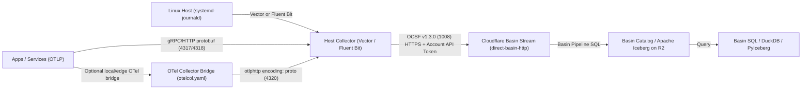

# Open Observability Framework (OOF)

**Open Observability Framework (OOF)** is a modular, AI-skill-driven framework for building **SIEM + APM** platforms using standard open telemetry schemas and direct-to-lakehouse shipping with minimal custom glue code.

Logs from **`systemd-journald`** and **OpenTelemetry (`OTLP`)** are normalized on the host by **Vector** or **Fluent Bit** into **OCSF v1.3.0 (`Event Log Activity`, `class_uid: 1008`)** and shipped directly over HTTPS (`direct-basin-http`) into **Cloudflare Basin -> Apache Iceberg on R2**.

---

## Architecture (`journald` / `OTLP` -> OCSF v1.3.0 -> Direct Basin HTTP -> Iceberg)



### Pluggable Framework Slots

| Slot | Default Choice | Alternatives / Extensions |
| :--- | :--- | :--- |
| `schema` | [OCSF v1.3.0 Event Log Activity (`1008`)](./contracts/ocsf/event-log-activity.basin.json) | Extensible via `schema.profile` (`ecs`, `cim`) — zero proprietary fields |
| `collect` | [Vector (`journald` + `otlp`)](./adapters/collect/vector-journald/vector.yaml) | [Fluent Bit (`systemd` + `opentelemetry`)](./adapters/collect/fluent-bit-journald/fluent-bit.conf), [OTel Collector Bridge](./adapters/collect/otel-collector-journald/otelcol.yaml), [Vector GitHub Actions Webhook](./adapters/collect/vector-github-actions/vector.yaml), [Direct GitHub Action](./adapters/collect/github-actions-direct/README.md), [Cloudflare Audit Logs Poller](./adapters/collect/cloudflare-audit-logs/README.md), [Vector Cloudflare Logpush](./adapters/collect/vector-cloudflare-logpush/vector.yaml), [Cloudflare GraphQL Exporter](./adapters/collect/cloudflare-graphql-exporter/README.md), [NixOS Flake Module](./flake.nix) |
| `detect` | Disabled by default (`detect.enabled: false`) | Host-agent (`yara-x` / `kunai`) or lakehouse-batch SQL rules |
| `ingest` | `direct-basin-http` (`http.enabled = true`, `http.authentication = true`) | Authenticated via Cloudflare Account API Token (`Pipelines Send` / `Basin Pipelines Send`) |
| `storage` | Cloudflare Basin Iceberg ([Terraform/OpenTofu](./adapters/storage/cloudflare-basin-iceberg/terraform/README.md) · [Pulumi TS](./adapters/storage/cloudflare-basin-iceberg/pulumi/README.md)) | [Pipeline SQL](./adapters/storage/cloudflare-basin-iceberg/pipeline.sql), inspected via Cloudflare `cf` CLI |
| `apm` | `metadata.correlation_uid` (`trace_id`) + `unmapped.span_id` | Full OTLP Traces + Metrics exporters via `otelcol.yaml` |
| `query` | Basin SQL & DuckDB | [Hunting SQL](./adapters/storage/cloudflare-basin-iceberg/queries/siem_hunting.sql), [GitHub Actions SQL (DuckDB)](./adapters/storage/cloudflare-basin-iceberg/queries/github_actions_monitoring.sql) · [(Basin SQL)](./adapters/storage/cloudflare-basin-iceberg/queries/github_actions_monitoring.basin.sql), [Cloudflare SQL (DuckDB)](./adapters/storage/cloudflare-basin-iceberg/queries/cloudflare_monitoring.sql) · [(Basin SQL)](./adapters/storage/cloudflare-basin-iceberg/queries/cloudflare_monitoring.basin.sql), [FinOps SQL (DuckDB)](./adapters/storage/cloudflare-basin-iceberg/queries/finops_monitoring.sql) · [(Basin SQL)](./adapters/storage/cloudflare-basin-iceberg/queries/finops_monitoring.basin.sql), PyIceberg, Spark |
| `finops` | Disabled by default (`enable_finops: false`) | [FOCUS v1.0 Contract](./contracts/focus/cost-and-usage.basin.json) · [FinOps Billing Collector](./adapters/collect/finops-billing/README.md) · [FOCUS Pipeline SQL](./adapters/storage/cloudflare-basin-iceberg/focus_pipeline.sql) |

---

## Repository Map

- [flake.nix](./flake.nix) — Nix Flake exposing `oof-tofu`, wrapped `oof-vector`/`oof-fluent-bit` configs & binaries, `devShells.default`, offline `checks`, and `nixosModules.default` (`services.oof-collector`)
- [manifest/stack.schema.json](./manifest/stack.schema.json) & [manifest/examples/cloudflare-basin-ocsf.yaml](./manifest/examples/cloudflare-basin-ocsf.yaml) — Declarative stack manifest schema & OCSF example
- [contracts/ocsf/event-log-activity.basin.json](./contracts/ocsf/event-log-activity.basin.json) & [contracts/ocsf/README.md](./contracts/ocsf/README.md) — Official OCSF v1.3.0 Event Log Activity (`1008`) Basin schema & field mapping specification
- [contracts/focus/cost-and-usage.basin.json](./contracts/focus/cost-and-usage.basin.json) & [contracts/focus/README.md](./contracts/focus/README.md) — Official FOCUS v1.0 Cost & Usage Basin schema for Cloudflare & GitHub FinOps monitoring
- [adapters/collect/finops-billing/collect-focus.mjs](./adapters/collect/finops-billing/collect-focus.mjs) & [adapters/collect/finops-billing/README.md](./adapters/collect/finops-billing/README.md) — Zero-dependency Node.js 20+ collector shipping Cloudflare R2/Pipelines & GitHub Billing Usage as FOCUS v1.0 directly to Basin HTTP
- [adapters/collect/vector-journald/vector.yaml](./adapters/collect/vector-journald/vector.yaml) — Vector `journald` + `otlp` collector with VRL OCSF v1.3.0 normalization & built-in unit tests
- [adapters/collect/vector-github-actions/vector.yaml](./adapters/collect/vector-github-actions/vector.yaml) — Vector GitHub Actions Webhook collector (`workflow_run`, `workflow_job`, security alerts) with HMAC-SHA256 verification & VRL OCSF v1.3.0 normalization
- [adapters/collect/github-actions-direct/](./adapters/collect/github-actions-direct/README.md) — Zero-dependency Node.js 20 GitHub Action (`action.yml`, `emit-ocsf.mjs`) shipping OCSF v1.3.0 directly to Basin HTTP
- [adapters/collect/fluent-bit-journald/fluent-bit.conf](./adapters/collect/fluent-bit-journald/fluent-bit.conf) & [adapters/collect/fluent-bit-journald/ocsf.lua](./adapters/collect/fluent-bit-journald/ocsf.lua) — Fluent Bit `systemd` + `opentelemetry` collector with Lua OCSF v1.3.0 normalization
- [adapters/collect/otel-collector-journald/otelcol.yaml](./adapters/collect/otel-collector-journald/otelcol.yaml) — OpenTelemetry Collector (`otlp` -> `otlphttp` protobuf bridge)
- [adapters/collect/prometheus-pull/prometheus.yml](./adapters/collect/prometheus-pull/prometheus.yml) & [adapters/collect/prometheus-pull/README.md](./adapters/collect/prometheus-pull/README.md) — Pull-based Prometheus `/metrics` scraper with strict metric/label allowlists, local TSDB time-series queries, and zero vs. scrape-failure/missing distinction (disabled by default in `services.oof-collector.prometheus`)
- [adapters/collect/cloudflare-audit-logs/](./adapters/collect/cloudflare-audit-logs/README.md) — Checkpointed Cloudflare Account Audit Logs API poller (bounded multi-page pagination + atomic checkpointing + OCSF v1.3.0 normalization)
- [adapters/collect/vector-cloudflare-logpush/](./adapters/collect/vector-cloudflare-logpush/README.md) — Vector Cloudflare Logpush HTTP Push receiver (`http_requests`, `firewall_events`, `dns_logs`, `access_requests`, `gateway_dns`) with shared-token verification & OCSF v1.3.0 normalization
- [adapters/collect/cloudflare-graphql-exporter/](./adapters/collect/cloudflare-graphql-exporter/README.md) — Zero-dependency Node.js 22+ loopback Prometheus exporter for Cloudflare GraphQL Analytics (`httpRequests1mGroups`)
- [adapters/storage/cloudflare-basin-iceberg/terraform/](./adapters/storage/cloudflare-basin-iceberg/terraform/README.md) & [adapters/storage/cloudflare-basin-iceberg/pulumi/](./adapters/storage/cloudflare-basin-iceberg/pulumi/README.md) — Declarative Cloud IaC (`OpenTofu/Terraform` and `Pulumi TypeScript`, including optional `logpush_jobs` / `logpushJobs`), [pipeline.sql](./adapters/storage/cloudflare-basin-iceberg/pipeline.sql), [siem_hunting.sql](./adapters/storage/cloudflare-basin-iceberg/queries/siem_hunting.sql), [github_actions_monitoring.sql](./adapters/storage/cloudflare-basin-iceberg/queries/github_actions_monitoring.sql), and [cloudflare_monitoring.sql](./adapters/storage/cloudflare-basin-iceberg/queries/cloudflare_monitoring.sql)
- [tests/ocsf-contracts.test.mjs](./tests/ocsf-contracts.test.mjs), [tests/prometheus-metrics.test.mjs](./tests/prometheus-metrics.test.mjs), & [tests/cloudflare-telemetry.test.mjs](./tests/cloudflare-telemetry.test.mjs) — Zero-dependency contract, Cloud IaC mock-API lifecycle, live Vector & Fluent Bit E2E wire/schema tests, live Prometheus pull E2E tests, and Cloudflare Audit Logs / Logpush / GraphQL Exporter E2E tests
- [skills/](./skills/compose-observability-stack/SKILL.md) — Agent skills (`compose-observability-stack`, `setup-cloudflare-basin-iceberg`)

---

## Quick Verification (Local)

```bash
# 1. Run full Nix Flake checks (Terraform validate, Pulumi typecheck, NixOS module eval, OCSF E2E suite)
nix flake check

# 2. Validate Vector config + VRL OCSF unit tests inside the dev shell
nix develop -c bash -c '
  VECTOR_DANGEROUSLY_ALLOW_ENV_VAR_INTERPOLATION=true \
  OOF_VECTOR_DATA_DIR="$(mktemp -d)" \
  OOF_BASIN_ENDPOINT="https://example.ingest.cloudflare.com" \
  OOF_INGEST_TOKEN="dummy" \
    vector validate --no-environment adapters/collect/vector-journald/vector.yaml
  VECTOR_DANGEROUSLY_ALLOW_ENV_VAR_INTERPOLATION=true \
  OOF_VECTOR_DATA_DIR="$(mktemp -d)" \
  OOF_BASIN_ENDPOINT="https://example.ingest.cloudflare.com" \
  OOF_INGEST_TOKEN="dummy" \
    vector test adapters/collect/vector-journald/vector.yaml
'

# 3. Run full contract + IaC + live Vector & Fluent Bit E2E wire conformance suite directly
nix develop -c node --test tests/ocsf-contracts.test.mjs
```

## Deploying to Cloudflare Basin & Linux Hosts

- **Cloud IaC (Terraform / OpenTofu or Pulumi)** + **`cf` CLI verification**: see [skills/setup-cloudflare-basin-iceberg/SKILL.md](./skills/setup-cloudflare-basin-iceberg/SKILL.md) (and module READMEs under `terraform/` and `pulumi/`).
- **NixOS host collectors (`services.oof-collector`)**: import `oof.nixosModules.default` from [flake.nix](./flake.nix) and supply an out-of-store `environmentFile` (`OOF_BASIN_ENDPOINT` / `OOF_BASIN_HOST`, `OOF_INGEST_TOKEN`).

## License

Licensed under the [Apache License, Version 2.0](./LICENSE).
