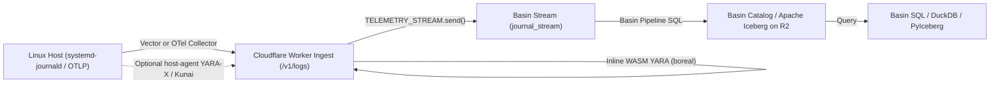

# Open Observability Framework (OOF)

**Open Observability Framework (OOF)** is a modular, AI-skill-driven framework for building **SIEM + APM** platforms by composing best-of-breed services per layer with minimal glue code.

Phase 1 delivers a complete, verified reference pipeline from Linux **`systemd-journald`** through inline **YARA** threat detection into **Cloudflare Basin (Apache Iceberg on R2)**, designed to grow cleanly into full APM (`trace_id`/`span_id`/OTLP) correlation.

---

## Architecture (Phase 1: `journald` -> YARA -> Basin Iceberg)



### 6 Pluggable Slots

| Slot | Phase 1 Default | Alternatives / Extensions |
| :--- | :--- | :--- |
| `collect` | [Vector (`journald`)](file:///home/reta/.herdr/worktrees/open-observability-framework/adapters/collect/vector-journald/vector.yaml) | [OTel Collector (`journald` + `otlp`)](file:///home/reta/.herdr/worktrees/open-observability-framework/adapters/collect/otel-collector-journald/otelcol.yaml), Fluent Bit |
| `detect` | [Edge WASM YARA (`boreal`)](file:///home/reta/.herdr/worktrees/open-observability-framework/adapters/detect/yara-wasm/src/lib.rs) | [Host-side YARA-X / Kunai](file:///home/reta/.herdr/worktrees/open-observability-framework/adapters/detect/host-yara-x/README.md), Hybrid |
| `ingest` | [Cloudflare Worker Ingest](file:///home/reta/.herdr/worktrees/open-observability-framework/adapters/ingest/cloudflare-worker-basin/src/index.ts) | Direct Basin HTTP |
| `storage` | [Cloudflare Basin Iceberg](file:///home/reta/.herdr/worktrees/open-observability-framework/adapters/storage/cloudflare-basin-iceberg/provision-basin.sh) | Dual-table fan-out (`pipeline-fanout.sql`) |
| `apm` | `trace_id` / `span_id` / `service_name` envelope fields | Full OTLP Traces + Metrics via OTel Collector |
| `query` | Basin SQL & DuckDB | [Hunting SQL](file:///home/reta/.herdr/worktrees/open-observability-framework/adapters/storage/cloudflare-basin-iceberg/queries/siem_hunting.sql), PyIceberg, Spark |

---

## Repository Map

- [manifest/stack.schema.json](file:///home/reta/.herdr/worktrees/open-observability-framework/manifest/stack.schema.json) & [manifest/examples/cloudflare-basin-siem.yaml](file:///home/reta/.herdr/worktrees/open-observability-framework/manifest/examples/cloudflare-basin-siem.yaml) — Declarative stack manifest schema & Phase 1 example
- [contracts/schemas/journal-logs.basin.json](file:///home/reta/.herdr/worktrees/open-observability-framework/contracts/schemas/journal-logs.basin.json) & [contracts/telemetry-envelope.md](file:///home/reta/.herdr/worktrees/open-observability-framework/contracts/telemetry-envelope.md) — Canonical 24-field SIEM+APM envelope & Basin stream schema
- [rules/yara/linux_journal_core.yar](file:///home/reta/.herdr/worktrees/open-observability-framework/rules/yara/linux_journal_core.yar) — Core Linux / `journald` YARA rules
- [adapters/detect/yara-wasm/](file:///home/reta/.herdr/worktrees/open-observability-framework/adapters/detect/yara-wasm/Cargo.toml) — Pure-Rust `boreal` YARA engine compiled to `wasm32-unknown-unknown` (zero runtime `WebAssembly.Module()` codegen, compatible with Cloudflare Workers)
- [adapters/ingest/cloudflare-worker-basin/](file:///home/reta/.herdr/worktrees/open-observability-framework/adapters/ingest/cloudflare-worker-basin/src/index.ts) — Minimal TypeScript Worker (`POST /v1/logs`, `GET /healthz`)
- [adapters/storage/cloudflare-basin-iceberg/](file:///home/reta/.herdr/worktrees/open-observability-framework/adapters/storage/cloudflare-basin-iceberg/provision-basin.sh) — Wrangler provisioning script, Basin SQL pipelines, and hunting queries
- [skills/](file:///home/reta/.herdr/worktrees/open-observability-framework/skills/compose-observability-stack/SKILL.md) — Agent skills (`compose-observability-stack`, `setup-cloudflare-basin-iceberg`, `manage-yara-detection`)

---

## Quick Verification (Local)

```bash
# 1. Test Rust YARA engine and build WASM binary
cargo test --manifest-path adapters/detect/yara-wasm/Cargo.toml
./skills/manage-yara-detection/scripts/build-yara-wasm.sh

# 2. Typecheck and run Worker + WASM YARA integration tests
npm --prefix adapters/ingest/cloudflare-worker-basin install
npm --prefix adapters/ingest/cloudflare-worker-basin run typecheck
npm --prefix adapters/ingest/cloudflare-worker-basin test

# 3. Validate Basin provisioning plan without touching Cloudflare
./adapters/storage/cloudflare-basin-iceberg/provision-basin.sh --dry-run \
  --bucket oof-telemetry --namespace siem --table journal_logs
```

## Deploying to Cloudflare Basin

See [skills/setup-cloudflare-basin-iceberg/SKILL.md](file:///home/reta/.herdr/worktrees/open-observability-framework/skills/setup-cloudflare-basin-iceberg/SKILL.md) for the complete provisioning and deployment runbook.
